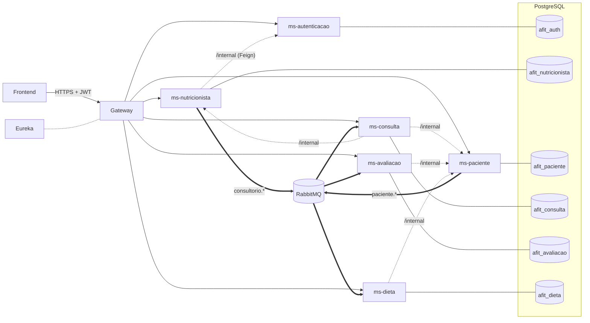
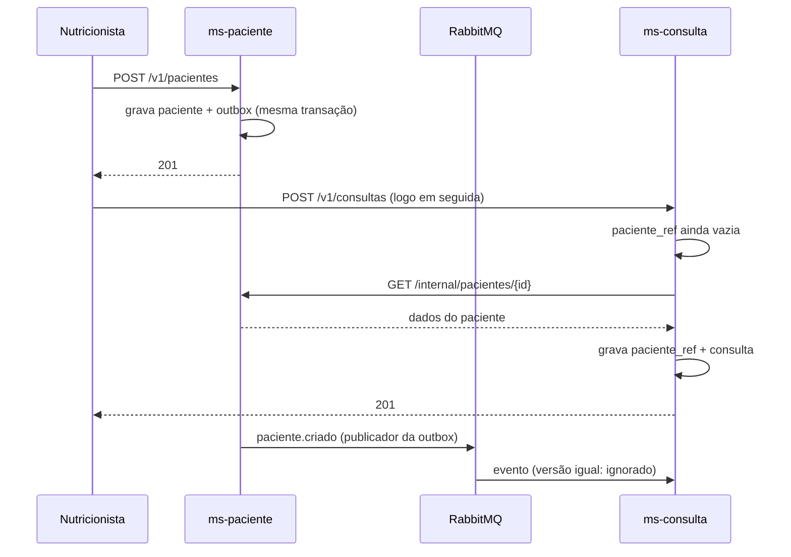
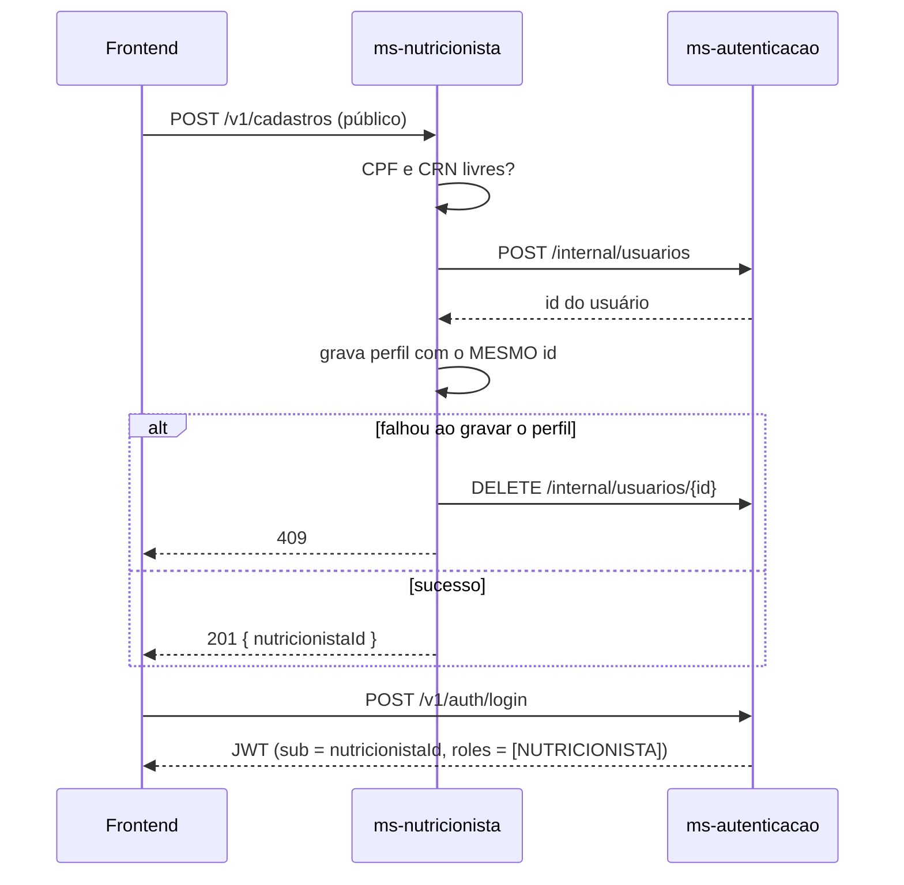

# AFitCenter — Arquitetura do backend

Microsserviços Spring Boot atrás de um API Gateway, com descoberta via Eureka, um banco PostgreSQL por serviço e eventos no RabbitMQ. O padrão (JWT ES256, token interno, outbox, Compose com overlays) segue o dos projetos ATCARE e UNICOS. Como rodar: [backend/README.md](../backend/README.md).

## Visão geral

Setas cheias: chamadas HTTP. Pontilhadas: chamadas internas síncronas (só quando necessário). Duplas: eventos.

## Fronteiras

Um serviço por contexto de negócio, não por tabela. Cada serviço é o único dono dos seus dados; os outros só os enxergam por API ou por réplica.

| Serviço | Requisitos | Dono de |
| --- | --- | --- |
| ms-autenticacao | — | usuário (credencial), aceite de termos |
| ms-nutricionista | 7 | nutricionista, consultório |
| ms-paciente | 1 | paciente, contatos, catálogo de condições, condições do paciente, medicamentos |
| ms-consulta | 2, 4 | consulta (agenda), análise |
| ms-avaliacao | 3, 6 | métrica, região corporal, equipamento, avaliação e resultados, meta, exame e resultados, série de evolução |
| ms-dieta | 5 | grupo alimentar, alimento, medidas caseiras, nutrientes, restrições por condição, dieta, refeição, itens, substitutos |

Duas escolhas de agrupamento:

- **Avaliações e exames juntos.** Os dois usam o mesmo catálogo de métricas, e a tela de evolução mistura os dois (peso e % de gordura ao lado de glicemia e colesterol). Separados, a evolução viraria uma composição entre serviços.
- **Alimentos e dietas juntos.** Montar e totalizar uma dieta lê a composição dos alimentos o tempo todo. Separados, cada tela de dieta faria dezenas de chamadas remotas.

## Isolamento entre nutricionistas

O sistema é multi-nutricionista e o **nutricionista é o tenant**.

- O perfil do nutricionista tem o **mesmo UUID** do usuário no ms-autenticacao. O JWT carrega esse id (`sub`) e o papel (`roles`), e o tenant sai direto do token: `UsuarioAutenticado.nutricionistaId()`.
- Toda tabela raiz (paciente, consulta, avaliação, exame, meta, dieta) tem `nutricionista_id`, e todo acesso filtra por ele. Recurso de outro nutricionista responde **404**, para não revelar que existe.
- Cada nutricionista tem a **própria ficha** do paciente. A mesma pessoa atendida por dois nutricionistas tem duas fichas independentes: CPF único **por nutricionista** (índice parcial), e o "CPF já cadastrado" de um nunca revela pacientes do outro.
- Nos serviços consumidores, as **FKs compostas** `(paciente_id, nutricionista_id) → paciente_ref (id, nutricionista_id)` fazem o próprio banco recusar uma consulta, avaliação ou dieta que misture paciente e nutricionista diferentes.
- **Portal do paciente (futuro):** `paciente.usuario_id` e o papel `PACIENTE` já existem. Um único login de paciente vai enxergar todas as fichas ligadas a ele, uma por nutricionista.

## Segurança

| Camada | O que faz |
| --- | --- |
| JWT ES256 | Só o ms-autenticacao tem a chave **privada** e emite tokens. Gateway e serviços validam com a **pública**: um serviço comprometido não consegue forjar identidade. |
| Gateway | Rejeita JWT inválido, devolve 404 para `/{servico}/internal/**` e `/{servico}/actuator/**`, remove headers reservados (`X-Internal-Token`, `X-Afit-*`) e aplica CORS. Não tem nenhum segredo. |
| Cada serviço | Valida o JWT de novo (`core-web`). Rotas `/v1/**` exigem o papel `NUTRICIONISTA`. |
| Rotas internas | `/internal/**` exigem o `X-Internal-Token`. Um JWT de usuário **nunca** concede acesso interno, e as chamadas Feign levam só o token interno, nunca o JWT do usuário. |
| Senhas | bcrypt; limite de tentativas por e-mail; e-mail inexistente e senha errada respondem igual, com tempo parecido. |
| Eureka | Basic auth: ninguém registra instância falsa. |
| Containers | Cada um recebe só as variáveis que usa; em produção, filesystem só leitura e sem capabilities. |
| LGPD | Aceite de termos versionado; exclusão lógica de prontuário (consulta, análise, paciente); dados pessoais fora dos logs. |

Erros seguem **Problem Details** (RFC 9457) em todos os serviços e no Gateway: `type`, `title`, `status`, `detail`, `instance`, `timestamp` e, em validação, `erros` por campo.

## Comunicação entre serviços

### Síncrona: Feign em `/internal/**`

Usada só quando a resposta é necessária na hora.

| Quem chama | Rota | Para quê |
| --- | --- | --- |
| ms-nutricionista | `POST /internal/usuarios`, `DELETE /internal/usuarios/{id}` (ms-autenticacao) | Cadastro: cria a credencial; desfaz se o perfil falhar |
| ms-consulta, ms-avaliacao, ms-dieta | `GET /internal/pacientes/{id}` (ms-paciente) | Réplica ainda sem o paciente (evento não chegou) |
| ms-consulta | `GET /internal/consultorios/{id}` (ms-nutricionista) | Idem, para consultório |
| ms-avaliacao, ms-dieta (a implementar) | `GET /internal/consultas/{id}` (ms-consulta) | Validar o vínculo com a consulta |
| ms-dieta (a implementar) | `GET /internal/pacientes/{id}/condicoes-ativas` (ms-paciente) | Alertar alimentos restritos ao montar a dieta |

### Assíncrona: eventos no RabbitMQ

Exchange `afitcenter.eventos` (topic). Cada consumidor tem a própria fila, com DLQ (`<fila>.dlq`) no exchange `afitcenter.eventos.dlx`. Os eventos carregam o **estado atual** do agregado e uma **versão**.

| Routing key | Produtor | Filas consumidoras |
| --- | --- | --- |
| `paciente.criado` / `paciente.atualizado` / `paciente.excluido` | ms-paciente | `ms-consulta.paciente`, `ms-avaliacao.paciente`, `ms-dieta.paciente` |
| `consultorio.criado` / `consultorio.atualizado` / `consultorio.desativado` | ms-nutricionista | `ms-consulta.consultorio` |

- **Outbox:** o evento é gravado na tabela `outbox_evento` na **mesma transação** da alteração. Se a transação falhar, o evento some junto. Um publicador agendado envia os pendentes com `FOR UPDATE SKIP LOCKED` (várias réplicas não duplicam) e só os marca como publicados depois da confirmação do broker.
- **Entrega "pelo menos uma vez":** o consumidor aplica o evento só se a versão for mais nova que a da réplica. Reentregas e mensagens fora de ordem são ignoradas sem erro.
- **Falhas:** 3 tentativas com espera crescente, depois a mensagem vai para a DLQ.

### Réplicas e o "acabei de cadastrar"

A réplica guarda só o necessário (nome, sexo, nascimento, status, se foi excluído). Assim, a agenda mostra o nome do paciente sem chamar o ms-paciente a cada linha, e a consulta continua funcionando mesmo com o ms-paciente fora do ar.

## Fluxos principais

### Cadastro do nutricionista (saga com compensação)

Se a própria compensação falhar, fica uma credencial sem perfil (o login funciona, mas as rotas do nutricionista respondem 404) e o erro vai para o log para remoção manual.

## Dados

- **Um banco por serviço**, no mesmo PostgreSQL, cada um com usuário próprio que só acessa o seu banco. Nenhum serviço lê o banco de outro.
- **Migrações Flyway por serviço:** `db/migration/common` (todos os ambientes, incluindo os catálogos) e `db/migration/local` (dados fictícios, só no perfil `local`). O Hibernate só valida (`ddl-auto=validate`).
- **Versão** (`@Version`) nas tabelas que publicam eventos: bloqueio otimista (409 em edição simultânea) e ordem dos eventos nas réplicas.
- **Exclusão lógica** (`deletado_em`) em paciente, consulta, análise, avaliação, exame e dieta. Auditoria (`criado_em`, `atualizado_em`) em todas as tabelas de cadastro.

### Diferenças em relação ao MER

O [MER](MER.md) continua sendo o modelo lógico. Na divisão física por serviço:

- Endereço virou colunas na própria tabela dona (nutricionista, consultório, paciente). Contatos do paciente viraram a tabela `paciente_contato`.
- Não existem FKs entre serviços. Paciente e consultório são **réplicas** (`paciente_ref`, `consultorio_ref`) com FK composta local. `consulta_id` na avaliação, no exame e na dieta é validado por API.
- `condicao_restricao.condicao_id` (ms-dieta) aponta para o catálogo do ms-paciente, sem FK.
- O script único [database/01_schema.sql](../database/01_schema.sql) fica como referência do modelo; o esquema real está nas migrações de cada serviço.

## Convenções de API

- Prefixo `/v1`. Pelo Gateway: `/{servico}/v1/...` (ex.: `/ms-paciente/v1/pacientes`).
- Ids UUID (catálogos usam inteiros). Datas e horas em ISO 8601 com fuso (`2026-10-08T07:26:00-03:00`).
- Listas paginadas: `{ conteudo, pagina, tamanho, totalElementos, totalPaginas }`, parâmetros `pagina` e `tamanho`.
- `DELETE` de prontuário é exclusão lógica. Para desmarcar consulta, prefira o status `CANCELADA`.
- Swagger de cada serviço em `/{servico}/swagger-ui.html`, só nos perfis `local` e `homolog`.

## Próximos passos

| Item | Onde |
| --- | --- |
| CRUD de avaliações (com resultados), metas, exames (com anexos e resultados), evolução e comparação | ms-avaliacao |
| CRUD de alimentos próprios e medidas, dietas, refeições, itens e substitutos, modelos e versões, totais, alertas de restrição | ms-dieta |
| Importar a TACO/TBCA como migração do catálogo de alimentos | ms-dieta |
| Armazenamento dos anexos de exame (MinIO/S3 com URL assinada) | ms-avaliacao + Compose |
| Valores de %VD dos nutrientes (IN ANVISA nº 75/2020) | ms-dieta |
| Refresh token, limite de requisições no Gateway, rastreamento distribuído, CI | transversal |
