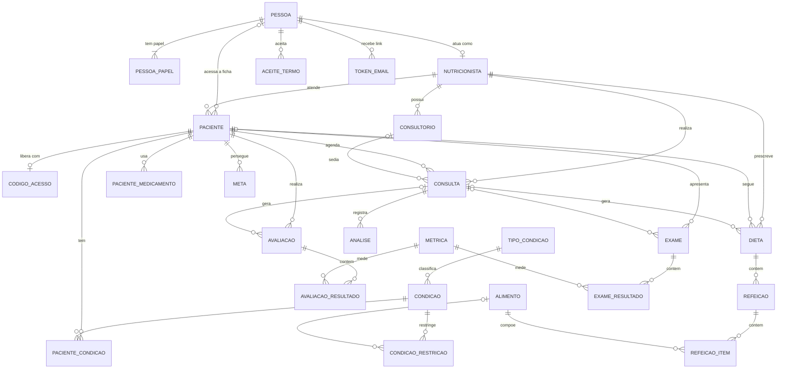
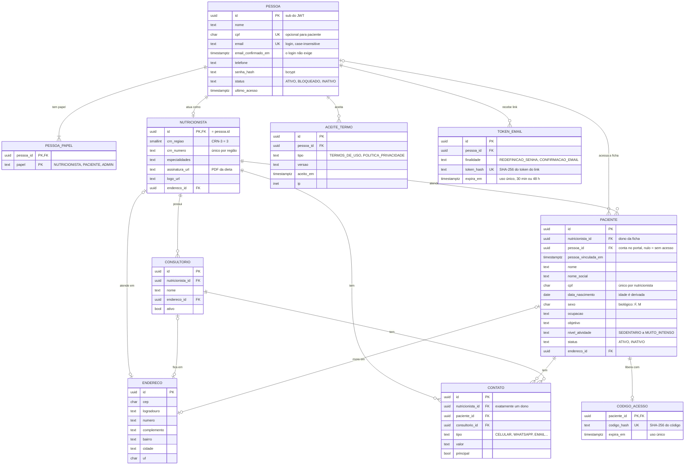
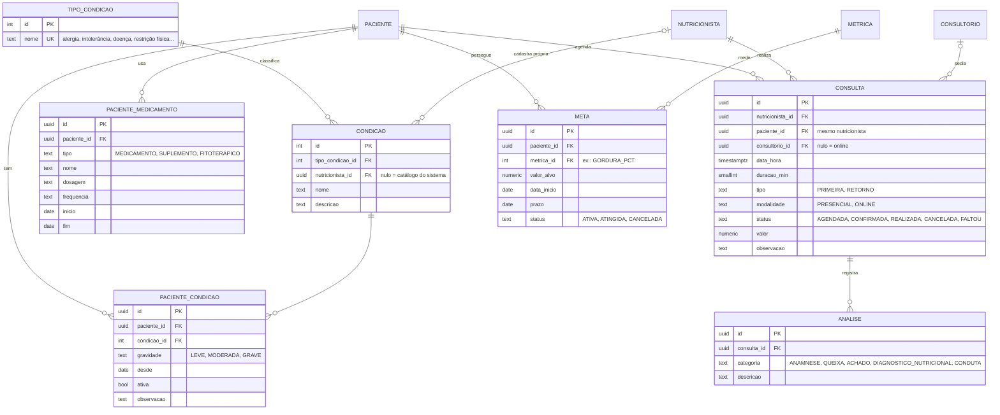
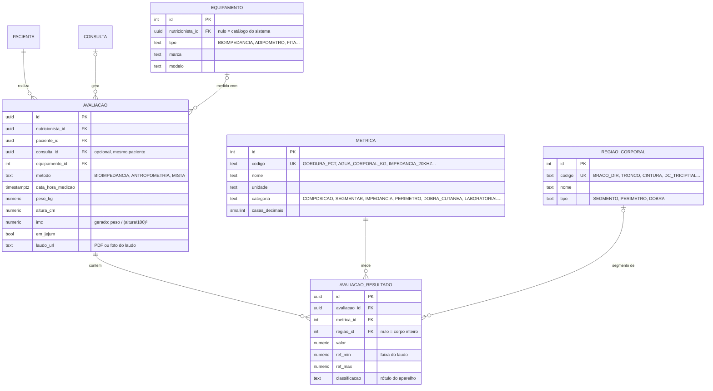
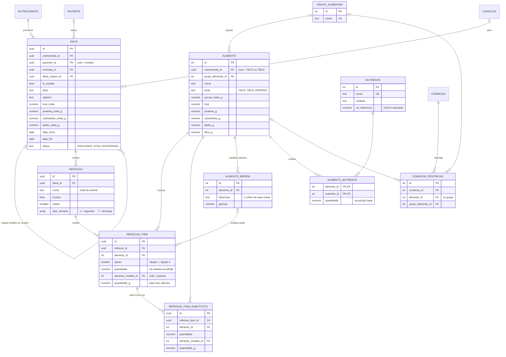
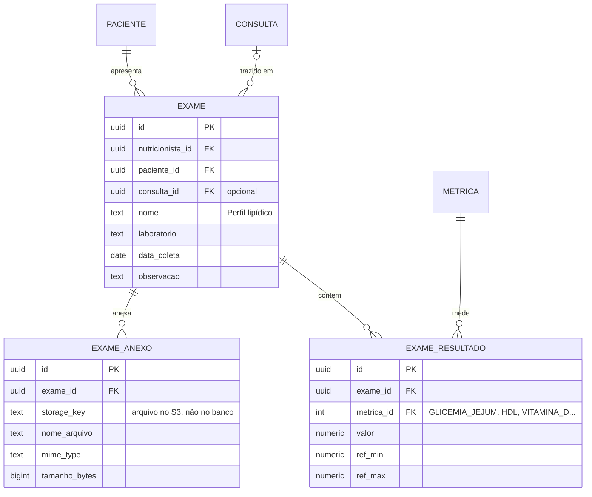

# AFitCenter — MER revisado (v1)

## Decisões

| Decisão | Consequência no modelo |
|---|---|
| Vários nutricionistas, cada um com seus pacientes | O nutricionista é o *tenant*. Cada um tem a **própria ficha** do paciente; a mesma pessoa pode ter fichas em vários nutricionistas, isoladas entre si. CPF é único **por nutricionista**. |
| Estudante fora da v1 | Entidade removida (volta depois como papel ligado a um nutricionista supervisor). |
| Nutricionistas e pacientes acessam o sistema | `PESSOA` é quem acessa: nome, CPF, e-mail (login), telefone, senha e um ou mais papéis (`PESSOA_PAPEL`). O nutricionista é o perfil profissional da pessoa (mesmo id). O paciente cria a própria conta e liga as fichas com o código de acesso que o nutricionista gera: um login enxerga todas as fichas dele, uma por nutricionista (`paciente.pessoa_id`). |

## Convenções

- **Tabelas raiz** (paciente, consultorio, consulta, avaliacao, dieta, exame) têm `nutricionista_id`. Tabelas de detalhe herdam o dono pelo pai.
- **FKs compostas** garantem que a consulta, avaliação, dieta e exame apontem para um paciente do **mesmo** nutricionista, e que avaliação/dieta/exame de um paciente não fiquem ligados à consulta de outro.
- **Catálogos** com `nutricionista_id` nulo são do sistema; preenchido = cadastro próprio do nutricionista (condicao, alimento, equipamento).
- **Auditoria** (`criado_em`, `atualizado_em`) em todas as tabelas de cadastro; **exclusão lógica** (`deletado_em`) em paciente, consulta, analise, avaliacao, dieta e exame. Essas colunas foram omitidas dos diagramas.
- **Idade e IMC são derivados**: idade de `data_nascimento`; IMC é coluna gerada, `peso_kg / (altura_cm/100)²`.

---

## Visão geral

---

## 1. Acesso e cadastro (requisitos 1 e 7)

Uma conta por pessoa, com um ou mais papéis: a nutricionista que também é paciente de um colega usa o mesmo login. Os dados pessoais ficam na pessoa; o nutricionista guarda só o perfil profissional, com o mesmo id.

## 2. Prontuário: condições, consultas e análises (requisitos 1, 2 e 4)

## 3. Avaliação corporal e evolução (requisito 3)

Cada valor do laudo vira uma linha em `AVALIACAO_RESULTADO`. Com `regiao_id` nulo, é o valor do corpo inteiro; preenchido, é o valor do segmento. O laudo Relaxmedic de 08/10 inteiro cabe em 49 linhas. Peso e altura ficam em colunas da avaliação porque são obrigatórios e o IMC é calculado a partir deles. A view `vw_evolucao` junta tudo, inclusive exames, numa série única pra gráficos e comparações.

## 4. Dieta e alimentos (requisito 5)

## 5. Exames (requisito 6)

